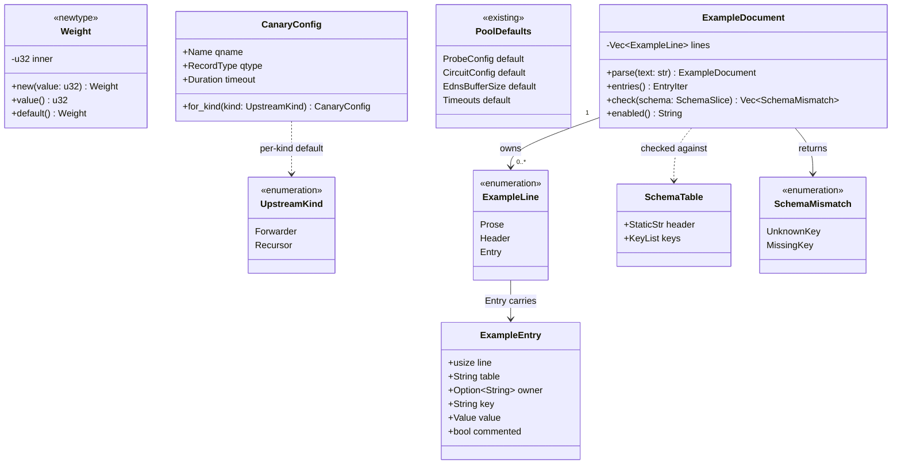

# Config defaults review fixes

## Requirements

Make every configuration default a single fact that the parsers, the example config and
the tests all read from, so that a stale default or a key missing from the example fails
the gate instead of misleading a user.

- Resolve the pool defaults (weight, EDNS buffer, probe, circuit, canary) through the
  `Default` of the type that owns them. The raw-table parsers stop carrying their own
  copies of the numbers.
- Give a canary table that omits `timeout_ms` the same per-kind timeout that an absent
  table already gets: forwarder 2s, recursor 5s.
- Keep `config/styx.example.toml` honest. It lists every key of the server, supervisor,
  upstream and recursion tables, its commented-out values equal the real defaults, and
  both are checked by tests.
- Detect a new config key at compile time: each raw config struct is destructured
  exhaustively next to its key list, so adding a field fails the build until the list
  and the example are updated.
- Replace the pattern-guessing example scanner with a parse-based one that reports the
  offending line.
- Document the two user-visible changes: the 5s default query deadline, and the
  per-kind canary timeout. Tell first-run users that the example's `root_hints` path is
  relative to the working directory.

### Non-goals

- No derived or pool-dependent query timeout default. The default stays a fixed 5s and
  the invariant "query_timeout exceeds every member timeout" is unchanged.
- No change to the member timeout defaults (UDP 2s, TCP 3s).
- No macro-generated config structs and no serde field-capture machinery.
- No marker-prefix convention in the example file; it stays plain `# key = value`.
- No change to which keys are required. `qname` and `qtype` stay required whenever a
  canary table is present.
- No new validation of probe or circuit values; zero stays accepted as it is today.
- The server-level and supervisor constants (UDP payload size, TCP idle timeout,
  concurrency caps, backoff constants) already have one literal each and stay as they
  are. The example is checked against them, but they are not moved.
- Live values in the `[recursion]` section are not asserted against defaults. Only its
  commented-out keys are.
- Example values that span several lines are not supported by the scanner.

## Entities

The diagram is a map. The signatures in Operations are the contract. `Value` is
`toml::Value`; `StaticStr` is `&'static str`, `KeyList` is `&'static [&'static str]`,
`SchemaSlice` is `&[SchemaTable]` and `EntryIter` is an `impl Iterator` over
`&ExampleEntry`, all flattened because Mermaid mangles nested and reference types.

### Changed existing types

- `Weight` keeps its private field and accessors, loses `Default` from its derive list
  and gains a manual `Default` whose value is one. Nothing calls the old derived
  default, so no caller changes.
- `CanaryConfig`, `ProbeConfig`, `CircuitConfig`, `EdnsBufferSize` and `Timeouts` are
  unchanged. They already carry the documented defaults; the work is to consume them.
- The private raw structs (`RawConfig`, `RawSupervisorConfig`, `RawPoolConfig`,
  `RawUpstreamConfig`, `RawCanaryConfig`, `RawProbeConfig`, `RawCircuitConfig`,
  `RawRecursion`) are unchanged. They gain a test-only exhaustive destructure beside
  them.

### New types

- `ExampleDocument`, `ExampleEntry`, `SchemaTable` and `SchemaMismatch` live in
  `styx-testkit`. `ExampleLine` is private. `ExampleEntry` and `SchemaTable` are plain
  data with no invariant, so every field is `pub`; `ExampleDocument` guards its
  classification, so its field is private. No type mixes `pub` and private fields.
- `SchemaMismatch` is the only error-shaped type, a closed enum that tests print. It is
  a test-support type, not a production boundary.

## Approach

1. Single source for defaults:
   - The domain types own their defaults. The parsers ask the type, with
     `map_or`-style resolution, instead of restating a number.
   - Canary resolution moves from "2s regardless of kind" to `CanaryConfig::for_kind`,
     so the absent-table and present-table paths cannot diverge.
   - Trade-off: `Weight` gains a deliberate `Default` of one. A derived zero was the
     only default in the set that contradicted the documentation, and no code used it.

2. Compile-time key tracking, scoped by owner:
   - Each crate that parses a table destructures its own raw structs exhaustively, with
     no `..`, beside a key manifest for those tables. Adding a field breaks the build
     until the manifest is updated, and the manifest check then fails until the example
     mentions the key.
   - `styx-resolution` covers the server, supervisor and upstream tables; `styx-recursion`
     covers `[recursion]`. A feature crate may not name another, so one crate cannot
     cover both.
   - The composition root `styx` keeps one test that the whole example parses through
     both parsers, which no single feature crate can do.

3. A shared parse-based scanner:
   - The scanner lives once, in `styx-testkit`, which every feature crate already uses
     as a dev-dependency and which names no feature crate. It adds the `toml` workspace
     dependency.
   - A line is a candidate when, with its leading `#` removed, it parses as TOML: either
     a single `key = value` or a table header. Prose fails to parse and is dropped, so
     no pattern guesses are needed.
   - Table attribution follows the headers as written, live or commented. An entry
     inside an array-of-tables span is tagged with that span's `name` value, so two
     members can carry the same key with different meaning.

4. Value checks by comparison, not by mapping tables:
   - The example is switched on (every commented entry and header uncommented) and
     parsed by the real parsers. The resulting values are compared with the types'
     defaults. A wrong comment fails because the parsed value differs from the default.
   - Server-level values are compared with the parse of a minimal config, which is the
     authoritative statement of "what you get when you omit the key".

5. Errors, dispatch and concurrency:
   - Production code gains no new error type and no new trait, so dispatch does not
     arise. All new generic-free helpers are plain functions and `impl Iterator`.
   - Nothing runs on a hot path and nothing is shared across tasks. All new code is
     startup-time parsing or test code.
   - Scanner failures are values (`Vec<SchemaMismatch>`), never panics, because
     `styx-testkit` is library code under the panic lints. Test files assert on them.

6. Documentation:
   - The changelog records the two behaviour changes; the README states the 5s deadline
     and the working-directory rule for `root_hints`.

## Structure

### Crate and Module Layout

1. `crates/styx-testkit/src/config_example.rs` — the scanner: parsing, classification,
   table and owner tracking, `enabled()`. Declared `pub mod config_example;` in
   `lib.rs`. Flat, with no layer split, like the rest of the crate.
2. `crates/styx-testkit/src/config_example/schema.rs` — `SchemaTable`, `SchemaMismatch`
   and the `check` logic, re-exported from `config_example`.
3. `crates/styx-resolution/src/domain/weight.rs` — manual `Default`.
4. `crates/styx-resolution/src/domain/config.rs` — parsers resolve through `Default`
   and `for_kind`. Gains `#[cfg(test)] mod schema_keys;`, backed by
   `crates/styx-resolution/src/domain/config/schema_keys.rs`, private to the module.
5. `crates/styx-resolution/src/infrastructure/server.rs` — gains
   `#[cfg(test)] mod schema_keys;`, backed by
   `crates/styx-resolution/src/infrastructure/server/schema_keys.rs`. `server.rs` is at
   387 of 400 lines, so the declaration is the only addition allowed there.
6. `crates/styx-recursion/src/application/config.rs` — gains
   `#[cfg(test)] mod schema_keys;`, backed by
   `crates/styx-recursion/src/application/config/schema_keys.rs`.
7. `crates/styx-resolution/tests/config_defaults_tests.rs` — shrinks to minimal-config
   and default-resolution tests. `crates/styx-resolution/tests/config_example_tests.rs`
   is new and holds the example checks.
8. `crates/styx/tests/example_config.rs` — new composition-root test.
9. `config/styx.example.toml`, `README.md`, `CHANGELOG.md`, `AGENTS.md` — documentation
   edits.

### Trait Implementations

1. `Weight` implements `Default` by hand and keeps `Debug, Clone, Copy, PartialEq, Eq,
   PartialOrd, Ord, Hash`; removing `Default` from the derive list is the only change.
2. `ExampleEntry` derives `Debug, Clone, PartialEq` — `Debug` for failure output,
   `Clone` for test convenience, `PartialEq` for equality asserts. `toml::Value`
   supports all three.
3. `ExampleDocument` derives `Debug, Clone`. No `PartialEq`, it is not compared.
4. `SchemaTable` derives `Debug, Clone, Copy`; it holds only `'static` references, so
   `Copy` is free and lets manifests be `const`.
5. `SchemaMismatch` derives `Debug, Clone, PartialEq, Eq` and implements
   `std::error::Error` through `thiserror::Error`, with a lowercase message that names
   the line for an unknown key.

### Dependencies

1. `styx-testkit` gains `toml` (workspace dependency, already used by two crates). It
   still names no feature crate, which `arch-lint`'s `testkit-names-no-feature` rule and
   `xtask deps` enforce.
2. `styx-resolution` and `styx-recursion` already list `styx-testkit` under
   `[dev-dependencies]`. `styx` gains it there too, and nowhere else.
3. `styx-resolution` does not name `styx-recursion` or the reverse. Cross-crate checks
   happen only in `styx`, the composition root, which may name both.
4. The scanner depends on `toml` and `thiserror` only. It does not depend on any
   `hickory` item; the `hickory-dev-only` gate is unaffected.

### Layering Rules

1. Domain: only `weight.rs` and the parsing in `config.rs` change; neither gains I/O. The
   test child module reads the example through `include_str!` at compile time and imports
   no `std::fs` or `std::io` item, so `no-sync-io-resolution-domain` is not touched.
2. Application and infrastructure: only the test child modules are added; production
   paths are unchanged.
3. Composition root: the new test lives in `crates/styx/tests/`, not in `main.rs`.
4. Feature gates: nothing is gated. The `--no-default-features` headless build must still
   pass, since no `web` code changes.

## Operations

### Update Type - `Weight`

1. Location: `crates/styx-resolution/src/domain/weight.rs`.
2. Responsibility: state that an omitted weight means one, in the type, not the parser.
3. Definition: unchanged newtype over `u32`, private field.
4. Derives: remove `Default` from `#[derive(...)]`; keep the others.
5. Methods: add `impl Default for Weight` with `fn default() -> Self`, returning the
   value one. Doc comment: a member that sets no weight counts once under the `weighted`
   strategy.
6. Invariants: weight zero stays a legal explicit value; only the default changes.
7. Test: in the file's `#[cfg(test)] mod tests`, `default_weight_is_one` asserts that
   `Weight::default().value()` is one.

### Update Parsers - `domain/config.rs`

1. Location: `crates/styx-resolution/src/domain/config.rs`.
2. Add private `fn upstream_kind(raw: RawUpstreamKind) -> UpstreamKind` holding the
   mapping that `parse_member` performs today.
3. Add private `fn resolve_probe(raw: RawProbeConfig) -> ProbeConfig`. Logic: take
   `ProbeConfig::default()`; for each of `idle_window_secs`, `down_retry_secs` and
   `tick_secs`, use `Option::map_or` with `Duration::from_secs` and the default's field.
4. Add private `fn resolve_circuit(raw: RawCircuitConfig) -> CircuitConfig`. Logic: the
   same with `CircuitConfig::default()`; `failure_threshold` and `half_open_successes`
   fall back to the default's integers, `open_cooldown_secs` through `Duration::from_secs`.
5. `PoolConfig::from_raw` calls `resolve_probe` and `resolve_circuit` and no longer
   contains the literals 60, 10, 1, 3, 30 or 2.
6. `fn parse_canary(kind: UpstreamKind, raw: RawCanaryConfig) -> Result<CanaryConfig,
   ConfigError>`: the first parameter changes from `RawUpstreamKind` to `UpstreamKind`.
   - Parse `qname` and `qtype` exactly as today; the error paths
     (`ConfigError::Invalid` for a bad name or unsupported qtype) are unchanged.
   - The timeout is `raw.timeout_ms` through `Duration::from_millis`, falling back to
     `CanaryConfig::for_kind(kind).timeout`, evaluated lazily with `map_or_else`.
   - The descent check becomes `matches!(kind, UpstreamKind::Recursor)` and still
     returns `ConfigError::CanaryNotDescending` for the root or a one-label name.
7. `fn parse_member(m: RawUpstreamConfig) -> Result<UpstreamConfig, ConfigError>`:
   - Compute `kind` first through `upstream_kind(m.kind)`.
   - EDNS buffer: validate an explicit value with `EdnsBufferSize::new`, returning its
     `ConfigError` unchanged; use `EdnsBufferSize::default()` when absent.
   - Weight: `m.weight.map_or_else(Weight::default, Weight::new)`.
   - Canary: `m.canary.map(|raw| parse_canary(kind, raw)).transpose()?`.
   - Timeouts: unchanged, already through `Timeouts::default()`.
8. Invariants: no function exceeds 60 code lines, and nesting stays below 4. No literal
   duplicates a `Default`.

### Add Test Module - `domain/config/schema_keys.rs`

1. Location: `crates/styx-resolution/src/domain/config/schema_keys.rs`, declared in
   `config.rs` with `#[cfg(test)] mod schema_keys;`.
2. For each of `RawPoolConfig`, `RawUpstreamConfig`, `RawCanaryConfig`, `RawProbeConfig`
   and `RawCircuitConfig`, a private function `fn <name>_fields(raw: &<Type>)` whose
   body destructures every field with `field: _` and no `..`. Table-valued fields
   (`members`, `probe`, `circuit`, `canary`) are listed too.
3. A `const SCHEMA: &[SchemaTable]` with headers `[upstream]`, `[[upstream.members]]`,
   `[upstream.members.canary]`, `[upstream.probe]` and `[upstream.circuit]` and the leaf
   keys of the same structs, written next to the destructures.
4. Test `pool_schema_keys_match_the_example`: parse the example, call `check(SCHEMA)`, and
   assert the result is empty, printing the mismatches on failure. Bind each destructure
   function to a `fn` pointer so the compiler treats it as used.
5. The module uses no `unwrap`, `expect` or `panic!`; it asserts on values.

### Add Test Module - `infrastructure/server/schema_keys.rs`

1. Location: `crates/styx-resolution/src/infrastructure/server/schema_keys.rs`, declared
   in `server.rs` with `#[cfg(test)] mod schema_keys;`.
2. Destructure `RawConfig` (including `supervisor` and `upstream`) and
   `RawSupervisorConfig` exhaustively.
3. `const SCHEMA` with the top-level table (empty header) and `[supervisor]`; the
   `supervisor` and `upstream` fields are tables and are not listed as leaf keys.
4. Test `server_schema_keys_match_the_example`, as above.
5. Constraint: the only line added to `server.rs` is the `mod` declaration.

### Add Test Module - `application/config/schema_keys.rs`

1. Location: `crates/styx-recursion/src/application/config/schema_keys.rs`, declared in
   `config.rs` with `#[cfg(test)] mod schema_keys;`.
2. Destructure `RawRecursion` exhaustively (ten fields) and list the same keys under
   `[recursion]`.
3. Test `recursion_schema_keys_match_the_example` runs `check`.
4. Test `commented_recursion_keys_equal_the_defaults` parses the switched-on example
   with `RecursionConfig::from_toml_str` and asserts the result is `Some` with
   `capacity` equal to `InfraCapacity::default()`.

### Create Module - `styx-testkit::config_example`

1. Location: `crates/styx-testkit/src/config_example.rs` and `config_example/schema.rs`.
2. Responsibility: read an example TOML file the way a user edits it. Classify each
   line, keep table and owner, report mismatches against a manifest, and produce the
   fully-enabled text.
3. `ExampleDocument::parse(text: &str) -> ExampleDocument`:
   - For each line, with a one-based line number from `enumerate` and `saturating_add`:
     trim; note whether it began with `#`; strip one leading `#` and trim again.
   - A candidate starting with `[` that parses as a TOML table holding no values is a
     header; its text, as written, becomes the current table, and a header beginning
     with `[[` opens an owner span.
   - A candidate that parses to exactly one top-level key whose value is not a table is
     an entry, with that key and value, the current table and the `commented` flag.
   - Everything else, including blank lines and prose, is `Prose`.
   - The owner span ends at the next header whose path does not extend the array-of-
     tables path. When it ends, every entry in it receives the value of the live `name`
     key in that span, if any; otherwise the owner stays `None`.
4. `ExampleDocument::entries(&self) -> impl Iterator<Item = &ExampleEntry>` yields the
   entries in file order.
5. `ExampleDocument::check(&self, schema: &[SchemaTable]) -> Vec<SchemaMismatch>`:
   - For every entry whose table equals a schema header and whose key is not in that
     table's keys, emit `UnknownKey { line, table, key }`.
   - For every schema key that no entry mentions in its table, live or commented, emit
     `MissingKey { table, key }`.
   - Entries in tables the schema does not name are ignored; they belong to another
     crate. Unknown keys come first in line order, then missing keys in schema order.
6. `ExampleDocument::enabled(&self) -> String`: every commented header and commented
   entry replaced by its uncommented candidate text, all other lines unchanged, joined
   with newlines.
7. `SchemaMismatch` variants and messages (`thiserror`):
   - `UnknownKey { line: usize, table: String, key: String }` —
     `example line {line}: {key} is not a key of {table}`.
   - `MissingKey { table: String, key: String }` — `example never mentions {key} under
     {table}`.
8. Support changes: add `toml.workspace = true` to `Cargo.toml`, widen the `description`
   to mention example-config support, add the module to the crate-level doc comment and
   export `ExampleDocument`, `ExampleEntry`, `SchemaTable` and `SchemaMismatch`.
9. Invariants: no `unwrap`, `expect`, indexing or unchecked arithmetic; parsing never
   fails as a whole, an unparseable line is prose.

### Tests - `styx-testkit`

1. Location: `crates/styx-testkit/tests/config_example_tests.rs`.
2. Tests, each naming the behaviour it pins:
   - A prose line that contains an equals sign but is not valid TOML produces no entry.
   - A commented `key = value` line produces a commented entry in the table above it.
   - A commented header switches the table for the entries that follow it.
   - Two members with the same key carry different `owner` values.
   - A commented key unknown to the schema yields `UnknownKey` with its line number.
   - A schema key absent from the file yields `MissingKey`.
   - `enabled()` output parses as TOML and contains each previously commented entry.
   - Entries in a table the schema does not name are ignored.

### Update Example - `config/styx.example.toml`

1. Header comment: say the file lists every key of the server, supervisor, upstream and
   recursion sections, live or commented with its built-in default.
2. Under the recursor member add a commented canary block: header
   `# [upstream.members.canary]`, `qname = "root-canary.iana.org."`, `qtype = "NS"`,
   `timeout_ms = 5000`. Reword the neighbouring prose to say each kind has its own
   default canary, and to say the recursor name needs two or more labels.
3. Under the forwarder member keep the commented canary block (`probe.canary.invalid.`,
   `A`, `2000`) and say it is the forwarder default.
4. In `[recursion]` add commented `max_delegations = 10000` and `max_servers = 10000`
   with a one-line comment on what they bound.
5. Add a line after `root_hints` that the path is relative to the directory styx is
   started from.
6. Each prose comment must fail TOML parsing; do not write a prose line shaped like
   `key = value`.

### Rewrite Tests - `styx-resolution/tests`

1. `config_defaults_tests.rs` keeps only: the minimal config is accepted; the default
   query deadline outlasts every default member timeout; and these new tests:
   - A member without weight, EDNS buffer or timeouts equals `Weight::default()`,
     `EdnsBufferSize::default()` and `Timeouts::default()`.
   - A pool without probe or circuit tables equals `ProbeConfig::default()` and
     `CircuitConfig::default()`.
   - A probe table that sets one key keeps the defaults for the other two.
   - A forwarder canary table without `timeout_ms` has a 2s timeout; a recursor one has
     5s; an explicit `timeout_ms` wins for both.
   - A recursor canary naming the root or a one-label name is still rejected.
2. `config_example_tests.rs` (new) holds the example checks, using the testkit scanner:
   - The example parses as written.
   - The switched-on example parses and yields a canary on both a forwarder and a
     recursor member.
   - The switched-on example equals the defaults: each member's weight, EDNS buffer and
     timeouts; each canary equals `CanaryConfig::for_kind` of the member's kind; the
     probe and circuit equal their defaults; the server's UDP payload size, TCP idle
     timeout and limits equal those of the minimal-config parse; the supervisor equals
     `SupervisorBackoffPolicy::default()`.
3. Remove the hand-copied `SCHEMA` and key lists and the line-scanning helpers.
4. Assertion failures use `assert_eq!` with a message naming the example key.

### Add Test - `styx` composition root

1. Location: `crates/styx/tests/example_config.rs`; add `styx-testkit` to
   `crates/styx/Cargo.toml` under `[dev-dependencies]`.
2. Tests: the example parses through `ServerConfig::from_toml_str` and
   `RecursionConfig::from_toml_str`, with a pool and a `[recursion]` section; the same
   holds for the switched-on text; the pool has a recursor member, so the recursion
   section is required and present.
3. The example is read by `include_str!` from `config/styx.example.toml`.

### Update Documentation

1. `CHANGELOG.md`, under `[Unreleased]`, add a `### Changed` list:
   - Breaking: the default `query_timeout_secs` is now 5 (it was 2), so a dead upstream
     takes up to 5s to answer SERVFAIL and shutdown may wait up to 5s.
   - A recursor canary table without `timeout_ms` now uses 5s (it was 2s).
   - A pool member's default weight is one, as documented.
2. `README.md`: say that `query_timeout_secs` defaults to 5 and must exceed every member
   timeout, say that `root_hints` in the example resolves from the working directory,
   and extend the "lists every key" sentence to cover the recursion section.
3. `AGENTS.md`: update the `styx-testkit` entry in the repository conventions and the
   layout diagram to mention the example-config scanner.

### Verify

1. Run `just gate`. It must pass formatting, markdown, clippy, `arch-lint`, the link
   graph and `hickory-dev-only` checks, `module-size` and the tests.
2. Run `cargo test -p styx-testkit -p styx-resolution -p styx-recursion -p styx`.
3. Run `cargo build -p styx --no-default-features`.
4. Confirm `arch-lint` treats the out-of-line test modules as test code; the modules
   avoid `unwrap` and `expect` either way.

## Norms

1. Naming: full words, `snake_case` functions, `UpperCamelCase` types, no stutter.
   `ExampleDocument` reads as `config_example::ExampleDocument`; the module name is not
   repeated inside methods. Accessors have no `get_` prefix.
2. Error handling: production code adds no error type. The scanner returns values, not
   `Result`, because nothing in it can fail as a whole. `SchemaMismatch` messages are
   lowercase, carry the line number or the table and key, and have no trailing
   punctuation.
3. Panics: no `unwrap`, `expect`, `panic!`, `todo!` or `unimplemented!` outside tests,
   and none in the new test child modules either. Indexing and arithmetic stay checked;
   line numbers use `saturating_add`.
4. Defaults: a number that a type's `Default` states must not appear again in a parser.
   The parser calls the type.
5. Dispatch: prefer generics and `impl Trait`. No new `dyn` and no tuples on public
   interfaces; `SchemaTable` and `ExampleEntry` are named structs.
6. Visibility: test helpers stay private to their module. `SchemaTable` and
   `ExampleEntry` are public because other crates' tests use them, and they expose all
   their fields or none.
7. Logging: `tracing` only; none of this work logs.
8. Documentation: `///` on every public item, including `ExampleDocument`'s methods with
   `# Errors` omitted because they cannot fail. Doc comments on the example file state
   behaviour, not history.
9. Testing: unit tests beside the code in `#[cfg(test)]` modules; integration tests in
   `tests/` through the public API. Test names state the behaviour they pin. Fakes are
   not needed; no I/O happens in the new tests.
10. Lints: `cargo fmt` is authoritative and `cargo clippy --all-targets -- -D warnings`
    must pass under the workspace lints. An `#[allow]` carries a reason; none is
    expected.
11. Markdown: this repository's markdown gate applies to the changelog, README and
    AGENTS.md edits; wrap prose at 90 columns.

## Safeguards

1. Functional constraints:
   - `query_timeout_secs` stays 5 and `check_deadline_covers` is unchanged.
   - A minimal config with one member and no timeout keys still starts.
   - Every explicit config value parses exactly as before. Only omitted values change,
     and only in two ways: a missing weight in a type that derived zero (no caller used
     it) and a recursor canary table without `timeout_ms` (2s to 5s).
2. Type-level constraints:
   - A new key in any raw struct fails compilation until the matching destructure and
     manifest are updated.
   - `Weight`'s field stays private; no `&mut` accessor or setter is added.
   - `SchemaTable` and `ExampleEntry` expose all fields or none; no type mixes `pub` and
     private fields (`partial_pub_fields`).
3. Error handling constraints:
   - No `unwrap`, `expect`, `panic!`, `todo!` or `unimplemented!` on any non-test path,
     including `styx-testkit`.
   - Scanner failures name the line (unknown key) or the table and key (missing key).
   - No error message exposes more than the example's own text.
4. Memory and ownership constraints:
   - `ExampleDocument` owns its lines and entries; `check` and `entries` borrow them.
   - Manifests are `'static` data; nothing is cloned in a loop.
5. Concurrency constraints:
   - None. No new shared state, task or lock.
6. Performance constraints:
   - All new work runs once at startup (parsing) or in tests. Parsing the example is
     bounded by its size; there is no per-query cost.
7. Security constraints:
   - The scanner reads trusted repository files only and is never linked into a shipping
     binary (`hickory-dev-only` and `xtask deps` keep `styx-testkit` on dev paths).
   - A canary or EDNS value outside its valid range is still rejected by the same
     constructors as before.
8. Compatibility constraints:
   - MSRV 1.96.0 and edition 2021, unchanged.
   - `Weight` losing a derived `Default` and gaining a manual one is source-compatible
     for callers that did not rely on a zero default. The crate is pre-1.0 (0.1.0).
   - The headless build with `--no-default-features` must still pass.
9. Build and lint constraints:
   - `cargo fmt --check`, `cargo clippy --all-targets -- -D warnings`, `cargo test`
     for the four touched crates, and `just gate`.
   - `xtask module-size`: every `.rs` file stays within 400 counted lines with no
     exemption. `server.rs` receives the single `mod` declaration and nothing else.
   - `clippy::too_many_lines` (60) and `excessive_nesting` (4) hold in every new
     function.
10. Test constraints:
    - Prove that a prose line shaped like `word = word` is dropped.
    - Prove that a commented key unknown to a manifest is reported with its line number.
    - Prove that a key missing from the example is reported.
    - Prove that a field added to a raw struct breaks compilation of its
      `schema_keys` module (by construction: the destructure has no `..`).
    - Prove that the switched-on example equals the defaults for weight, EDNS buffer,
      timeouts, probe, circuit, the per-kind canary, the server-level values and the
      supervisor.
    - Prove that a canary table without `timeout_ms` takes 2s for a forwarder and 5s
      for a recursor, and that an explicit value wins.
    - Prove that `Weight::default().value()` is one.
    - Prove that the whole example parses through both `ServerConfig` and
      `RecursionConfig` in the composition-root test.
